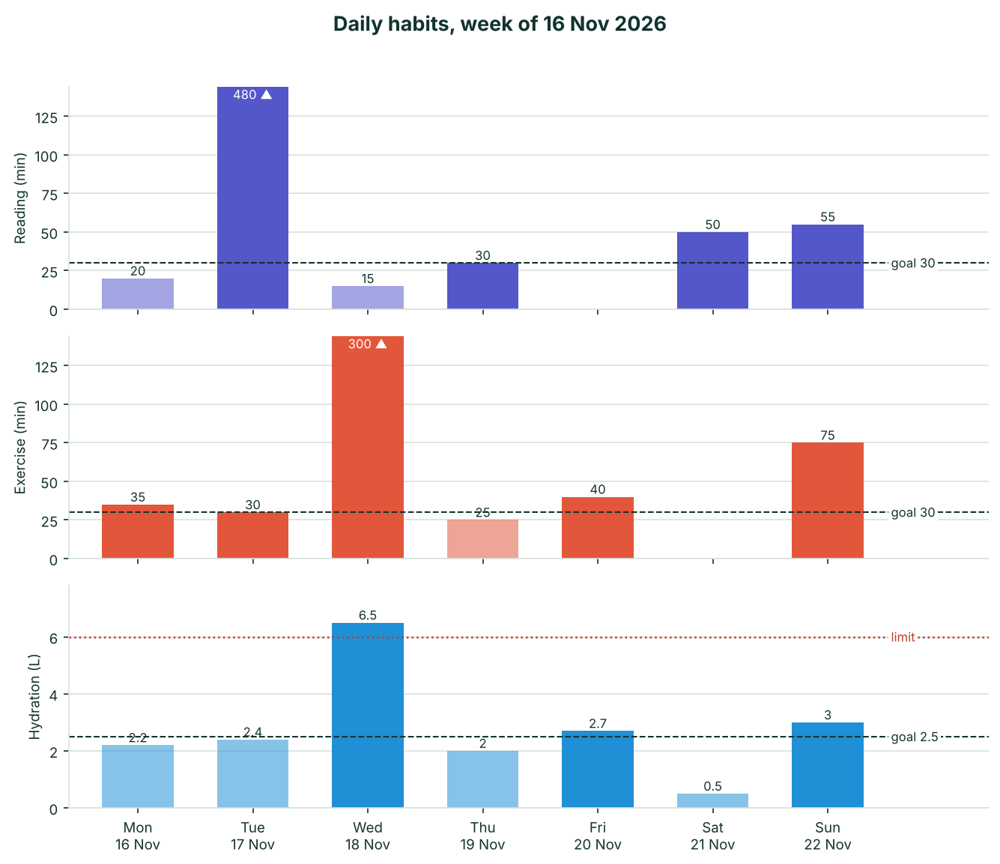
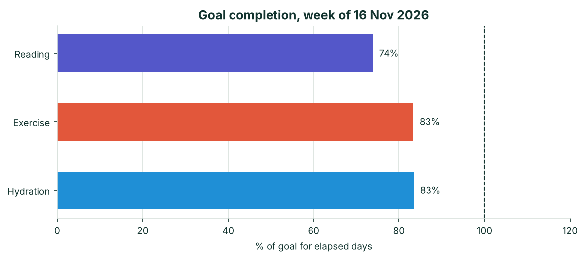
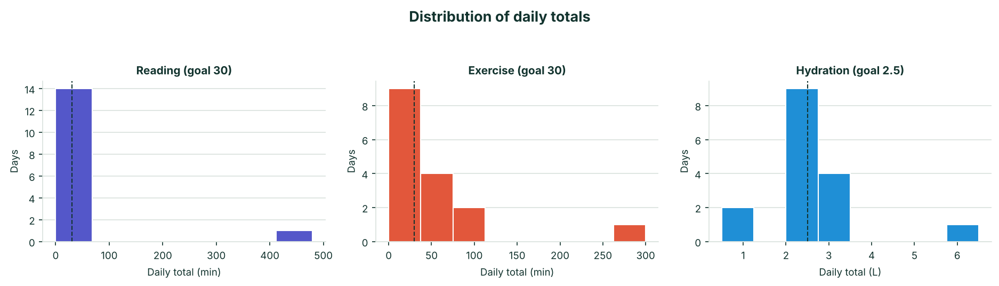
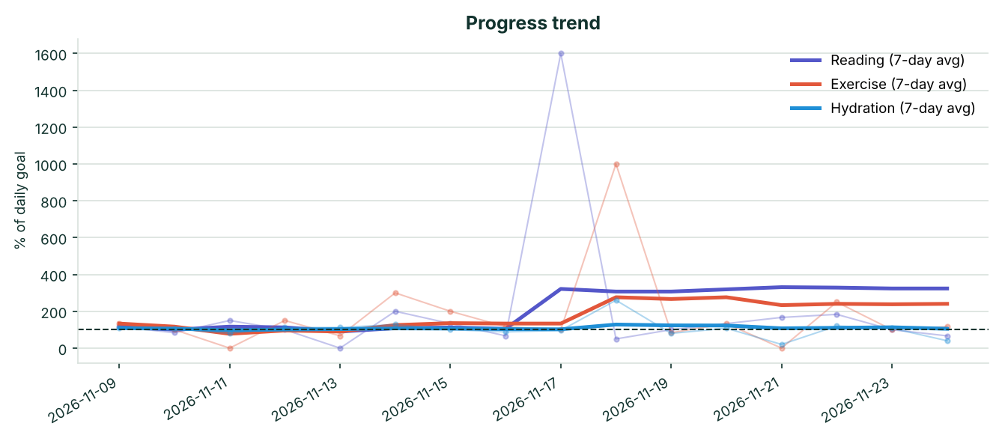

# Healthy Habit Tracker - Weekly Report

**Week:** 2026-11-16 to 2026-11-22  
**Generated:** 2026-11-24 12:29  
**Wellness score:** 80/100 (On track)  
**Entries this week:** 21

## Executive summary

| Habit | Total | Daily avg | Goal days met | Completion | Status | Trend | Streak |
|---|---:|---:|---:|---:|---|---|---:|
| Reading | 650 min | 92.86 min | 4/7 | 74% | Behind | Improving | 2 |
| Exercise | 505 min | 72.14 min | 5/7 | 83% | On track | Stable | 1 |
| Hydration | 19.3 L | 2.76 L | 3/7 | 83% | On track | Declining | 1 |

## Key trends

- Strongest habit: Hydration at 83% goal completion.
- Needs attention: Reading at 74% goal completion.
- Reading goal met on 4 of 7 days.
- Reading is improving through the week.
- Exercise goal met on 5 of 7 days.
- Hydration goal met on 3 of 7 days.
- Hydration is declining through the week.
- Hydration completion is down 14 points on the previous week.
- Longest current streak: Reading with 2 days in a row.

## Daily breakdown

| Habit | Mon 16 | Tue 17 | Wed 18 | Thu 19 | Fri 20 | Sat 21 | Sun 22 |
|---|---:|---:|---:|---:|---:|---:|---:|
| Reading (min) | 20 | 480 | 15 | 30 | 0 | 50 | 55 |
| Exercise (min) | 35 | 30 | 300 | 25 | 40 | 0 | 75 |
| Hydration (L) | 2.2 | 2.4 | 6.5 | 2 | 2.7 | 0.5 | 3 |

## Warnings

- **CRITICAL** - 2026-11-18: Hydration total 6.5 L is above the daily safety limit of 6 L.
- **WARNING** - 2026-11-21: only 0.5 L of Hydration (goal 2.5).
- **WARNING** - 2026-11-18: unusual Exercise entry #30 of 300 min (over 4x the daily goal). Please double-check it.
- **WARNING** - 2026-11-17: unusual Reading entry #26 of 480 min (over 4x the daily goal). Please double-check it.
- **INFO** - Reading streak of 3 days is at risk - today's total is 20 of 30 min.
- **INFO** - 2026-11-20: no Reading entry although other habits were logged.

## Charts

## Entries this week

| ID | Date | Habit | Value | Notes |
|---:|---|---|---:|---|
| 24 | 2026-11-16 | Exercise | 35 min | Jog |
| 25 | 2026-11-16 | Hydration | 2.2 L |  |
| 23 | 2026-11-16 | Reading | 20 min | Short session |
| 27 | 2026-11-17 | Exercise | 30 min | Gym |
| 28 | 2026-11-17 | Hydration | 2.4 L |  |
| 26 | 2026-11-17 | Reading | 480 min | Exam prep marathon (max entry) |
| 30 | 2026-11-18 | Exercise | 300 min | Charity half-marathon training (max entry) |
| 31 | 2026-11-18 | Hydration | 5 L | Long run recovery (max entry) |
| 32 | 2026-11-18 | Hydration | 1.5 L | Evening - limit breach day |
| 29 | 2026-11-18 | Reading | 15 min | Tired |
| 34 | 2026-11-19 | Exercise | 25 min | Walk |
| 35 | 2026-11-19 | Hydration | 2 L |  |
| 33 | 2026-11-19 | Reading | 30 min | Café study, chapter recap |
| 36 | 2026-11-20 | Exercise | 40 min | Evening badminton |
| 37 | 2026-11-20 | Hydration | 2.7 L | Forgot to log reading |
| 39 | 2026-11-21 | Exercise | 0 min | Rest day |
| 40 | 2026-11-21 | Hydration | 0.5 L | Forgot to drink |
| 38 | 2026-11-21 | Reading | 50 min | Library |
| 42 | 2026-11-22 | Exercise | 75 min | Trek |
| 43 | 2026-11-22 | Hydration | 3 L |  |
| 41 | 2026-11-22 | Reading | 55 min | Library visit |
